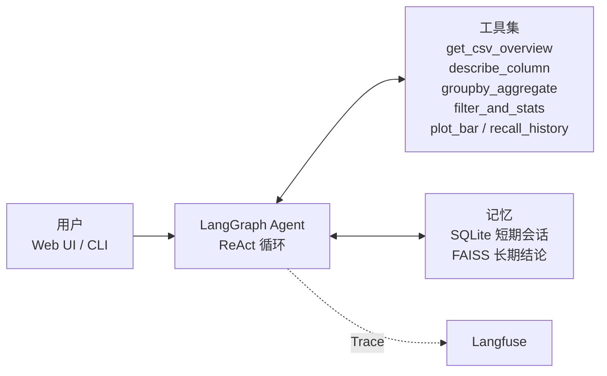

# CSV 数据分析 Agent

基于 LangGraph ReAct 循环的 CSV 数据分析智能体：会自己选工具算数、自己画图，全程 Langfuse 可观测，14 条评测用例 100% 通过。

## 架构



## 快速开始

### 本地运行

```bash
python -m venv .venv
.venv\Scripts\activate            # macOS/Linux: source .venv/bin/activate
pip install -r requirements.txt

copy .env.example .env            # 填入 DEEPSEEK_API_KEY 与 Langfuse 密钥
python webui.py                   # 打开 http://127.0.0.1:7860
```

命令行方式（csv 路径 + 问题 + 会话 id + prompt 版本）：

```bash
python main.py data/sales.csv "总销售额是多少？" s_regress v3
```

### Docker 运行

```bash
docker build -t data-analysis-agent .
docker run --env-file .env -p 7860:7860 data-analysis-agent
```

镜像内置 `fonts-noto-cjk`，图表中文不会出现方框；`.env` 不打进镜像，密钥由 `--env-file` 在运行时注入。

## 工具

| 工具 | 类别 | 用途 |
|---|---|---|
| `get_csv_overview` | 核心分析 | 读取表结构、列名、前几行与缺失值，分析前的必调步骤 |
| `describe_column` | 核心分析 | 对数值列做 describe 统计并返回 sum，是均值/极值类问题的依据 |
| `groupby_aggregate` | 核心分析 | 按维度分组做 sum/mean/max/min/count，并附带总计行 |
| `filter_and_stats` | 核心分析 | 条件筛选后求子集的总和与均值 |
| `plot_bar` | 可视化 | 分组求和画柱状图，保存到 `outputs/*.png`，网页里直接展示图片 |
| `recall_history` | 长期记忆 | 语义召回历史分析的结论，支持"上次""对比一下"这类追问 |

## Prompt 版本

| 版本 | 定位 | 说明 |
|---|---|---|
| v1 | 对照组 | 只给身份和数据文件路径，不含任何行为规则，用于量化"规范"带来的差异 |
| v2 | 实验版本 | 补四条约束：先看表结构再分析、一次只调一个工具、报错后修正重试、回答必须引用工具数字 |
| v3 | 修复版 | 在 v2 上增加"汇总数字必须直接引用工具返回值"，消除模型自行累加工具数字导致总计偏差的问题 |

`main.py` / `webui.py` 默认使用 v3，可通过 `python main.py ... v2` 切换对比。

## 评测

评测集 12 条用例（正向 6 / 边界 4 / 多轮 2，多轮拆成两行共 14 行），流水线四步：

```bash
python run_eval.py           # 跑 Agent，写 docs/eval_results.csv
python audit_numbers.py      # 数字可溯源初筛，写 number_audit 列
python eval_judge.py         # DeepSeek 三档评判，写 judge_suggestion 列
python make_report.py        # 汇总生成 docs/eval_report.md
```

最新结果：**14/14 合格，总通过率 100%**（正向 6/6、边界 4/4、多轮 4/4）。

## 项目结构

```
data_Analysis_Agent/
├── agent/
│   ├── graph.py            # LangGraph 图：agent <-> tools 循环
│   └── prompts.py          # SYSTEM_PROMPT_V1/V2/V3
├── tools/
│   ├── csv_tools.py        # CSV 读取与表结构概览
│   └── analysis_tools.py   # describe / groupby / filter / plot / recall
├── memory/
│   └── vector_store.py     # FAISS 长期记忆读写
├── data/sales.csv          # 示例数据：50 行，产品/销售额/月份
├── docs/
│   ├── eval_cases.json     # 评测用例集
│   ├── eval_results.csv    # 逐条运行与判分结果
│   └── eval_report.md      # 评测报告
├── tests/
├── main.py                 # CLI 入口
├── webui.py                # Gradio 网页入口（会话级记忆 + 图片展示）
├── run_eval.py             # 批量评测
├── audit_numbers.py        # 数字可溯源审计
├── eval_judge.py           # LLM 评卷
├── make_report.py          # 报告生成
├── Dockerfile
├── requirements.txt
└── .env.example
```
